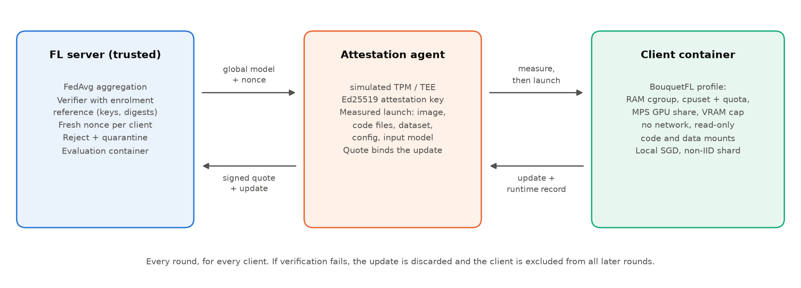
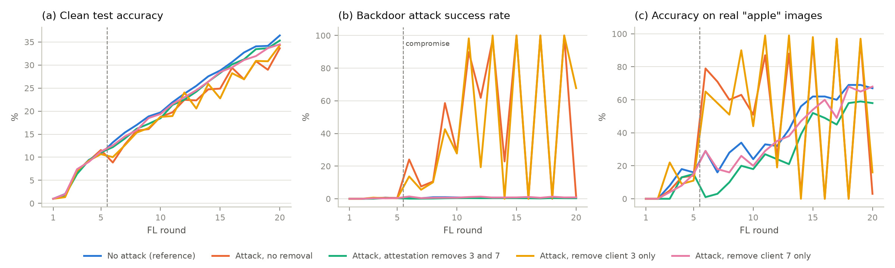

# FedAttest: Detecting Compromised Clients in Federated Learning

Hardware-heterogeneous federated learning on one machine (a Docker port of
BouquetFL, Geimer, arXiv:2602.06498), with **remote attestation of every client
update** to detect compromised clients, and a measurement of what removing those
clients does to accuracy and to a backdoor.



* **Data**: CIFAR-100, non-IID over 10 clients (Dirichlet α = 0.3 label skew)
* **Model**: CIFAR ResNet-18, half width (2.8 M params), FedAvg, 20 rounds
* **Clients**: each training round of each client runs in its own Docker
  container restricted to a sampled consumer hardware profile
* **Attacks** (from round 6): client 3 data poisoning (BadNets), client 7
  tampered training code (boosted model-replacement backdoor, γ = 3)
* **Detection**: remote attestation (measured launch + Ed25519-signed quote bound
  to a fresh server nonce, verified by the server), compared against a
  statistical update-outlier baseline

## Results

**Detection** (in the "attack, no removal" run; 15 compromised rounds per attacker, 370 honest client-rounds):

| Detector | Compromised client-rounds flagged | False alarms |
|---|---:|---:|
| Remote attestation | **30 / 30** | **0 / 370** |
| Update-statistics baseline | 22 / 30 | 0 / 370 |

Attestation names the cause: `DATA_MISMATCH` for client 3, `CODE_MISMATCH` (with the modified files) for client 7.
The baseline reliably saw only the boosted client 7.

**Removal** (clean accuracy = mean of the last 5 rounds; ASR = backdoor attack success rate, mean of the last 10 rounds):

| Scenario | Clean accuracy | ASR |
|---|---:|---:|
| No attack (reference) | 33.6% | 0.7% |
| Attack, no removal | 30.0% | 57.3% |
| **Attack, attestation removes 3 and 7** | **32.8%** | **0.4%** |
| Attack, remove client 3 only | 30.2% | 58.6% |
| Attack, remove client 7 only | 32.1% | 0.9% |

Removing the clients that failed attestation brings the backdoor from 57.3% to 0.4% and recovers 2.8 pp of clean
accuracy. Client 7's boosted, tampered code caused the backdoor; client 3's poisoning alone did not implant it.
One seed, 20 rounds: accuracy differences of 1–3 pp are indicative only.



## Layout

| Path | What it is |
|---|---|
| `docker/Dockerfile` | runtime image (PyTorch 2.6 + CUDA 12.4) for clients and server |
| `worker/` | the **approved client code** (`task.py`, `client_worker.py`), measured by attestation |
| `server/` | trusted server evaluation (`server_eval.py`) and the backdoor trigger (`backdoor.py`) |
| `bqfl/emulation.py` | BouquetFL emulation engine mapped onto Docker (cgroups, cpuset, CPU quota, CUDA MPS, VRAM cap), host profiling, hardware sampler, network model |
| `bqfl/attestation.py` | attestation agent (simulated TPM/TEE: Ed25519 key, measured launch, quotes) and verifier |
| `bqfl/server.py` | FL orchestrator: rounds, per-client containers, verification, FedAvg, evaluation |
| `bqfl/update_stats.py` | statistical baseline detector (robust z-scores of update norm / direction) |
| `adversary/` | the two compromises (dataset poisoning, code replacement) |
| `config/experiment.toml` | federation, attack and scenario settings |
| `config/hardware.toml` | client hardware profiles (sampled; edit to set them by hand) |
| `hwdb/` | GPU/CPU/location/ping tables from [BouquetFL](https://github.com/arnogeimer/bouquetfl) (Apache-2.0) |
| `results/` | `summary.json` (per-round metrics of all scenarios) and charts |

Attestation keys (`attestation_keys/`), data (`data/`) and run outputs (`runs/`, `logs/`) are created when you run the
experiments and are not part of the repository.

## Scenarios

| Scenario | Attack | Server policy |
|---|---|---|
| `clean` | none | FedAvg over all 10 |
| `attack_nodefense` | clients 3 and 7 | FedAvg over all 10 (attestation logged only) |
| `attack_attestation` | clients 3 and 7 | reject + quarantine clients that fail attestation |
| `remove_client3_only` | clients 3 and 7 | enforcement applied to client 3 only |
| `remove_client7_only` | clients 3 and 7 | enforcement applied to client 7 only |

## Run

Requirements: Linux, NVIDIA GPU + driver, Docker with the NVIDIA container
toolkit, user in the `docker` group, host Python ≥ 3.11 with `numpy`,
`cryptography`, `matplotlib`.

```bash
docker build -t bouquetfl-docker:latest docker/
# CIFAR-100 parquet files from huggingface.co/datasets/uoft-cs/cifar100 into data/
docker run --rm --user $(id -u):$(id -g) --security-opt label=disable \
  -v $PWD/data:/data -v $PWD/scripts:/scripts:ro bouquetfl-docker:latest \
  python /scripts/prepare_data.py --num-clients 10 --alpha 0.3
python3 scripts/setup_hardware.py 10 7      # writes config/host.json + config/hardware.toml
python3 -m bqfl.server smoke --rounds 2     # isolated run: used for the hardware timing table
scripts/run_all.sh                          # all five scenarios (share the GPU via MPS, 3 GPU slots)
python3 scripts/analyze.py                  # results/summary.json + PNGs
```

## Differences from BouquetFL (and why)

* **Containers instead of `systemd-run` subprocesses.** Same cgroup-v2 memory
  limit, plus network and filesystem isolation (`--network none`, read-only
  code/data mounts).
* **No sudo on this machine**, so GPU clock locking (`nvidia-smi -lgc`) and CPU
  frequency capping (`cpupower`) are replaced by per-container equivalents: the
  clock ratio is folded into the CUDA MPS thread percentage, and the CPU clock
  ratio into the Docker CPU quota (`--cpus`). GPU memory bandwidth is not
  restricted.
* **Flower is not used.** FedAvg is implemented directly in `bqfl/server.py` so
  the attestation checks sit in the aggregation path without framework
  plumbing. The per-client "spawn a restricted environment per fit" design
  from BouquetFL is kept.
* **Scenarios run concurrently** to fit the time budget. A file-lock semaphore
  keeps at most 3 GPU containers alive so VRAM contention cannot cause
  artificial out-of-memory errors. Learning results do not depend on timing;
  reported timings come from the isolated `smoke` run.

## Attestation threat model

The attestation agent runs on the host and stands in for a TPM/TEE: it holds
each client's signing key (never mounted into the container) and measures what
the container runs. An adversary who controls a client's workspace (its code and
data) is detected. An adversary who controls the platform itself, or data that
was poisoned before enrolment, is out of scope for attestation.

## Limitations

* Simulated root of trust: the agent runs on the host, not in a real TPM or SGX/TDX enclave.
* Data poisoned before enrolment passes attestation; attacks inside attested code are not caught.
* One seed, 20 rounds, half-width model; clock limits are approximated.

## Team

B.Tech research project, IIIT Allahabad (2026): Aashay Nema, Shaurya Bhandari, Subhansh Naithani.
